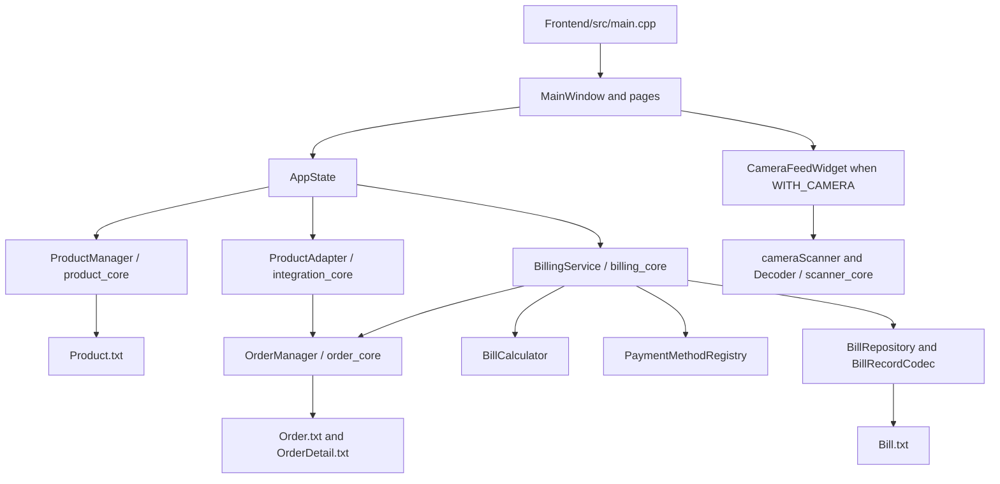

# BarcodeHub C++ file map and execution flow

Prepared for the Increment 2 evaluation on 19 November 2026 by inspecting the
current source and [CMakeLists.txt](../../CMakeLists.txt). This map distinguishes
compiled application code, optional camera code, tests and historical files.
The runtime evaluator should record today's observed results in the evaluation
report; a responsibility description below is not itself a passing runtime test.

## Start with the files the application actually builds

`Frontend/src/main.cpp` creates `QApplication` and `MainWindow`. `MainWindow`
creates the seven pages. Those pages call `AppState`, which translates Qt values
to the standard C++ backend. The build collects this backend through
`backend_core`, an interface target linking `integration_core` and `billing_core`
and their transitive dependencies. An interface target is a dependency grouping;
it does not have its own `.cpp` implementation.



## Every backend implementation file

All paths are linked to the actual source. The target column indicates whether
the file participates in the main application and under which build condition.

| File | Target/status | What this file does and where to explain it |
| --- | --- | --- |
| [ProductModel.cpp](../../Backend/src/product/ProductModel.cpp) | `product_core`, active | Implements measurement-unit conversion, PKR display formatting, EAN-8 digit/checksum helpers, `Product` construction and stock subtraction. `ProductDescriber` produces label/value descriptions and stock level; `TextProductFormatter` formats them as plain text. It does not read files. |
| [ProductStorage.cpp](../../Backend/src/product/ProductStorage.cpp) | `product_core`, active | Active `ProductParser` reads logical fields and multiword names from `Product.txt`; `ProductFileLoader` reports line errors/warnings and rejects duplicates. `ProductManager` stores the catalogue and ID/barcode indexes, supplies exact/code/text search, and separates in-memory deduction from `saveProducts`. Includes an older strict ten-token `ProductRecordCodec`, which is not the active loader. |
| [ProductValidation.cpp](../../Backend/src/product/ProductValidation.cpp) | `product_core`, active | Implements composable product rules for ID, barcode, acronym, name, price, stock and path. Checksum mismatch is a warning after eight-digit validation. `StockValidator` applies a stock policy, including the combined already-in-cart quantity. Catalogue stock is integer. |
| [Order.cpp](../../Backend/src/order/Order.cpp) | `order_core`, active | Converts order/payment enums to/from persisted strings; validates order ID shape, date/time shape, name and payment amount. A paid order must have a positive payment amount. This is record validation, not a complete order-state transition machine. |
| [OrderDetail.cpp](../../Backend/src/order/OrderDetail.cpp) | `order_core`, active | Validates a detail row's eight-digit order ID, nonempty product identity/barcode without record-breaking characters, and finite positive quantity. Details store identity and quantity, not historical product prices. |
| [OrderManager.cpp](../../Backend/src/order/OrderManager.cpp) | `order_core`, active | Owns backend cart add/merge/change/remove/clear, count versus weight rules, stock checks and cart totals. Allocates eight-digit order IDs; parses/writes order and detail files. `createOrder` saves details then header and clears its cart after success. Provides load/find/update/discard and best-effort rollback; does not own catalogue inventory. |
| [RecordText.cpp](../../Backend/src/common/RecordText.cpp) | `common_core`, active | Shared billing text helpers: encode/decode text fields, split `#`-terminated rows, parse finite numbers, format money to two decimals/quantity to three, round money, and obtain the local date. OrderManager contains similar private helpers of its own. |
| [BillCalculator.cpp](../../Backend/src/billing/BillCalculator.cpp) | `billing_core`, active | Validates bill-line numeric inputs, accumulates price/tax/discount times quantity, rounds component totals and computes payable. Tax and discount are currency amounts per unit, not percentages. Does not persist or contact a payment service. |
| [PaymentMethod.cpp](../../Backend/src/billing/PaymentMethod.cpp) | `billing_core`, active | Implements cash tender/change and card/wallet merchant-name validation. `PaymentMethodRegistry` selects the strategy for a payment mode. Card/wallet are local recording rules; no bank authorization or settlement occurs. |
| [BillRecordCodec.cpp](../../Backend/src/billing/BillRecordCodec.cpp) | `billing_core`, active | Formats/parses one twelve-field item row in `Bill.txt`. Rows repeat the bill header/totals. Validates field count, nine-digit bill ID, text encoding and finite numbers; does not fully validate business consistency of saved totals/status. |
| [BillRepository.cpp](../../Backend/src/billing/BillRepository.cpp) | `billing_core`, active | Loads bill rows and groups them by bill ID; refuses duplicate IDs when appending a bill. Rewrites through a temporary file and replacement fallback. Allocates nine-digit daily bill IDs. Does not charge payment or update stock. |
| [BillingService.cpp](../../Backend/src/billing/BillingService.cpp) | `billing_core`, active | Coordinates order lookup, detail loading, injected product lookup, bill preview/calculation, payment rules, ID allocation, paid-state update and bill save. Rejects paid/archived orders; attempts to restore the order if bill saving fails. Product lookup is a callback so billing need not own `ProductManager`. |
| [ProductAdapter.cpp](../../Backend/src/integration/ProductAdapter.cpp) | `integration_core`, active | Copies catalogue `Product` data to `order::ProductSnapshot`, including integer-to-text ID and integer-to-double stock conversion. This small adapter prevents order code from depending on Product's concrete class. |
| [CameraScanner.cpp](../../Backend/src/scanner/CameraScanner.cpp) | `scanner_core`, optional | Opens camera capture, requests frame size/FPS, reads frames, converts to grayscale, finds a likely barcode area and invokes `Decoder`. Offers timer-friendly frame processing plus a blocking scan with a 30-second limit. Returns error messages and releases capture. |
| [decoder.cpp](../../Backend/src/scanner/decoder.cpp) | `scanner_core`, optional | Implements EAN-8 pattern/run/module decoding, guard patterns, check-digit validation and scan-line/cropping attempts. Returns the full eight-digit code despite some historical variables being named `six`. It does not perform catalogue lookup. |
| [Billing.cpp](../../Backend/src/billing/Billing.cpp) | Empty, not in active targets | Placeholder with no implementation. Explain billing using the five active billing source files above. |

`CAMERA=OFF` omits `scanner_core`; `ON` requires OpenCV 4; `AUTO` enables it only
when discovery succeeds. CMake references `cameraScanner.cpp` while Git stores
`CameraScanner.cpp`, and the source uses a lowercase header include. Windows
usually resolves these case differences; case-sensitive systems may fail.

## Every frontend implementation file

| File | Target/status | Responsibility and presentation action |
| --- | --- | --- |
| [Frontend/src/main.cpp](../../Frontend/src/main.cpp) | `BarcodeHub`, active entry | Creates the Qt application, selects Fusion styling/font, applies the theme, constructs/shows `MainWindow` and runs the event loop. This is the main POS entry point. |
| [MainWindow.cpp](../../Frontend/src/ui/MainWindow.cpp) | `barcode_ui`, active | Owns sidebar/top bar/page stack, navigation, global search routing, F-key actions and toast messages. Connects Products/Scanner send-to-order signals to `RecordOrderPage::showCode`. Starts on Record Order. Handles close confirmation. |
| [AppState.cpp](../../Frontend/src/ui/AppState.cpp) | `barcode_ui`, active | Singleton bridge between widgets and backend. Locates data, loads catalogue/cache/history, exposes search/description/stock helpers and assembles checkout. Aggregates stock deductions, creates an order, backs up and saves stock, invokes billing, attempts rollback, refreshes history/cache and emits changes. This is the main file to explain integration. |
| [RecordOrderPage.cpp](../../Frontend/src/ui/RecordOrderPage.cpp) | `barcode_ui`, active | Customer strip, barcode/code lookup and preview, product-description action, manual-item action, cart table and quantity controls, totals, new draft and payment/checkout trigger. Uses a camera feed when enabled. Displays a receipt and clears the visible draft only after successful checkout. |
| [DashboardPage.cpp](../../Frontend/src/ui/DashboardPage.cpp) | `barcode_ui`, active | Summary cards, recent activity, low-stock actions, lookup and hourly revenue chart. Reads `AppState` data and updates on changes. Dashboard labels/charts should be checked against persisted paid orders rather than treated as independent accounting. |
| [OtherPages.cpp](../../Frontend/src/ui/OtherPages.cpp) | `barcode_ui`, active | Implements five pages in one file: Orders filtering/receipt/CSV export, Products search and description/add actions, Bills listing/receipt, Scanner lookup/camera/send-to-order, and Settings controls. Start here when asked where any of these pages is implemented. |
| [Dialogs.cpp](../../Frontend/src/ui/Dialogs.cpp) | `barcode_ui`, active | Builds receipt text/dialog, product description dialog, manual-item input and payment selection/tender dialog. Receipt is a displayed text document; presence of a receipt window does not imply printer/PDF integration. |
| [Widgets.cpp](../../Frontend/src/ui/Widgets.cpp) | `barcode_ui`, active | Reusable widget/UI helpers, painted cards, actual POS `CameraFeedWidget`, revenue chart and quantity stepper. Camera capture lives here in the main POS, with duplicate scan suppression and error signals. With camera disabled it displays unavailable status and emits an explanatory error. |
| [Theme.cpp](../../Frontend/src/ui/Theme.cpp) | `barcode_ui`, active | Draws icons, creates the application stylesheet, repolishes widgets and stores dark-mode preference through `QSettings`. This controls appearance rather than backend monetary rules. |
| [NavigationModel.cpp](../../Frontend/src/ui/NavigationModel.cpp) | Compiled in `barcode_ui` | Defines navigation item metadata. The current `MainWindow.cpp` also defines its own navigation labels/keys; do not assume changing this model alone changes the displayed sidebar. |
| [CameraWidget.cpp](../../Frontend/src/ui/CameraWidget.cpp) | Optional `CameraDemo` only | Standalone camera widget with timer capture, display conversion and barcode/error signals. The main POS instead uses `CameraFeedWidget` in `Widgets.cpp`. |
| [Frontend/src/ui/main.cpp](../../Frontend/src/ui/main.cpp) | Not selected by CMake | Older standalone `CameraWidget` launcher. It is not the main entry or the selected `CameraDemo` entry. |
| [POSWindow.cpp](../../Frontend/src/ui/POSWindow.cpp) | Empty, excluded | Placeholder. `MainWindow.cpp` implements the current POS window. |
| [legacy-camera/main.cpp](../../Frontend/legacy-camera/main.cpp) | Historical, excluded | Older standalone camera launcher, outside active CMake sources. |
| [legacy-camera/CameraWidget.cpp](../../Frontend/legacy-camera/CameraWidget.cpp) | Historical, excluded | Older camera widget implementation, outside main POS and current optional demo targets. |

## Other C++ files: tests and historical copies

| File | Executable/registration | What it exercises |
| --- | --- | --- |
| [product_tests.cpp](../../tests/product_tests.cpp) | `product_tests`; CTest `product` | Parser/validation, duplicate/malformed rows, EAN-8 warnings, lookup, stock policies, descriptions, actual fourteen-product fixture, writer/loader round trip. |
| [OrderManagementSmokeTest.cpp](../../tests/OrderManagementSmokeTest.cpp) | `order_tests`; CTest `order` | Cart arithmetic and invalid quantities, fractional backend weights, IDs, text escaping, order/detail save/load, status updates and malformed records. Plain checks remain active in Release. |
| [integration_test.cpp](../../tests/integration_test.cpp) | `integration_test`; CTest `integration` | Loads actual catalogue, types a known barcode, adapts the product, creates/reads order details and deducts stock in memory. Camera and Qt are excluded; it does not persist this deduction to repository stock. |
| [checkout_test.cpp](../../tests/checkout_test.cpp) | `checkout_test`; CTest `checkout` | Synthetic product lookup, preview, insufficient cash, successful cash/change, duplicate payment rejection, saved bill and paid-order reload. It does not call Qt `AppState::addOrder`. |
| [billing_tests.cpp](../../tests/billing_tests.cpp) | `billing_tests`; CTest `billing` | Nineteen cases covering arithmetic/rounding/invalid lines, payment strategies, codec errors/round trip, bill IDs and repository append/load/duplicate rejection. |
| [camera_demo.cpp](../../tests/camera_demo.cpp) | Optional `CameraDemo`, not CTest | Standalone Qt camera demonstration using `Frontend/src/ui/CameraWidget.cpp`. Requires an enabled camera build and hardware for capture checks. |
| [regression.cpp](../../tests/regression.cpp) | Historical/unregistered | References older generation/decoder/GUI interfaces. CMake does not build or register it; its presence cannot establish that current GUI regressions pass. |
| [Root cameraScanner.cpp](../../cameraScanner.cpp) | Historical/unselected | Root scanner copy; `scanner_core` selects the backend scanner directory instead. |
| [Root decoder.cpp](../../decoder.cpp) | Historical/unselected | Root decoder copy; not the decoder selected by active targets. |

These tables cover every checked-in `.cpp` outside generated/dependency `build`
folders. Header files declare interfaces, structs and some inline operations;
they are not additional application entry points.

## Explain one sale from input to disk

1. **Find a product.** A manual code or detected barcode reaches a page. The page
   calls `AppState::findByCode`, which uses the catalogue's barcode/ID/acronym
   search. Barcode decoding and catalogue lookup are separate responsibilities.
2. **Build the visible draft.** Record Order displays a product preview and adds
   integer quantities to its UI cart. Description opens catalogue information.
   Manual items are represented as receipt lines without catalogue stock.
3. **Validate checkout.** The payment dialog collects mode/tender/merchant.
   `AppState::addOrder` rebuilds an `OrderManager` cart from current snapshots,
   checks quantities/combined stock, compares totals and validates payment.
4. **Create the order.** `OrderManager` assigns `YYMM + sequence + DD`, writes
   `OrderDetail.txt` followed by `Order.txt`, and clears its backend cart.
5. **Save inventory.** AppState captures the original product-file bytes, deducts
   catalogue quantities in memory and saves `Product.txt`. Manual items do not
   deduct catalogue stock.
6. **Create the bill.** `BillingService` reloads details and resolves products
   through its injected callback, calculates totals, validates payment again,
   allocates `YYMMDD + sequence`, updates the order to paid and saves `Bill.txt`.
7. **Refresh the screen.** AppState refreshes caches/history; Record Order shows
   the receipt and clears its visible cart after success. Failures retain the
   visible draft for correction; file rollback is attempted as appropriate.

Concrete catalogue example: barcode `40001029` is milk, price 340, tax 0,
discount 10 per unit. Two units total PKR 660; tender 700 gives PKR 40 change.
A successful full checkout should reduce milk stock from 42 to 40 in a fresh
fixture copy and create matching order, detail and bill records. This is an
expected result for a manual case; today's runtime report must establish whether
the GUI path actually achieved it.

## Understand the four persistent files

| File | Writer/owner | What is retained |
| --- | --- | --- |
| `Product.txt` | ProductFileWriter / ProductManager | Catalogue identity, name, unit, per-unit price/tax/discount, integer stock and barcode image path |
| `Order.txt` | OrderManager | Order identity/date/time/customer, state, paid amount, payment mode and merchant |
| `OrderDetail.txt` | OrderManager | Order ID, product ID, barcode and quantity |
| `Bill.txt` | BillRecordCodec / BillRepository | One row per item, repeated bill header/totals, saved price/discount/quantity and payment status |

Text records end in `#`. Order/bill text uses escaping for spaces, underscores,
percent signs and terminators. Product names use a different multiword parsing
rule. Bill rows omit per-line tax, cash tender/change and full historical product
names; reloaded display can therefore combine saved totals and current metadata.
See [record layouts](../increment-2/records.md) for exact field order.

Temporary-file replacement and rollback are best-effort recovery, not a
multi-file database transaction. No shared lock/journal coordinates all writers.
Creating an order alone does not complete payment or inventory deduction.

## Build and run the registered backend checks

Run from the repository root with CMake, Ninja and a C++17 compiler available.
Use a new build directory if the existing one belongs to a different compiler.

```powershell
cmake -S . -B build/evaluation-backend -G Ninja -DCMAKE_BUILD_TYPE=Debug -DBACKEND_ONLY=ON -DCAMERA=OFF -DBUILD_TESTING=ON
cmake --build build/evaluation-backend --parallel 4
ctest --test-dir build/evaluation-backend --output-on-failure
ctest --test-dir build/evaluation-backend -N
```

`CAMERA=OFF` is necessary for a dependency-free backend build because camera
discovery precedes the `BACKEND_ONLY` return. `-N` lists the five registered
suites without executing them. Product/integration tests expect the shipped
fourteen-record catalogue; use the CTest-defined working directories.

To run one suite with detailed output:

```powershell
ctest --test-dir build/evaluation-backend -R '^checkout$' -V
```

For a Windows Qt build, use the compiler matching the installed Qt kit. The
following paths describe this workstation and are not universal installation paths:

```powershell
cmake -S . -B build/evaluation-gui -G Ninja -DCMAKE_BUILD_TYPE=Debug -DCAMERA=OFF -DBUILD_TESTING=OFF -DCMAKE_PREFIX_PATH=C:/Qt/6.11.0/mingw_64 -DCMAKE_CXX_COMPILER=C:/Qt/Tools/mingw1310_64/bin/g++.exe
cmake --build build/evaluation-gui --parallel 4
```

For camera work, configure a separate compatible build with `CAMERA=ON` and the
OpenCV installation path as needed. A camera-disabled successful build verifies
neither OpenCV linkage nor capture/decoding.

## Preserve real data during manual evaluation

`AppState::locateDataDir` tries `BARCODEHUB_DATA` first, then executable-relative
and working/source directories. The chosen folder must contain `Product.txt`;
an invalid override falls through to other folders. Copy the complete `data`
directory to a disposable rehearsal location and set `BARCODEHUB_DATA` to that
copy before launching. Verify all four target paths before testing checkout.
The catalogue's `data/barcodes/...` image paths are resolved from the parent of
the selected data folder, so preserve that directory structure in the copy.

The [seed-data script](../../cmake/seed-data.cmake) copies only missing starter
files when the app is built. Rebuilding is not an inventory reset. The
[Windows build helper](../../scripts/build-windows.ps1) also prepares dependencies,
tests and deployment; those packaging actions are separate from the core sale flow.

## What a complete evaluation must still distinguish

| Evidence | What it establishes | What it does not establish |
| --- | --- | --- |
| Backend build + five passing CTest suites | Current backend compiles and those assertions pass | GUI wiring, camera, printer, rollback faults, concurrent checkout |
| Qt app build | Current selected frontend sources compile/link | Successful launch or every user action |
| Launch and page navigation | App loads the chosen data and renders reachable pages | Correct settlement/persistence |
| Disposable checkout + file comparison + restart | That tested sale persisted expected records and reloads | Crash safety or all payment boundaries |
| Real camera frame capture | Selected camera supplies usable frames | Successful barcode decoding |
| Successful known-barcode detection | That fixture/lighting/orientation decoded | General accuracy for all labels |

Today's runtime outcomes belong in the companion evaluation report, including
exact build configuration, passing/failed cases and untested hardware paths.
Keep source-derived expectations separate from observed results.
