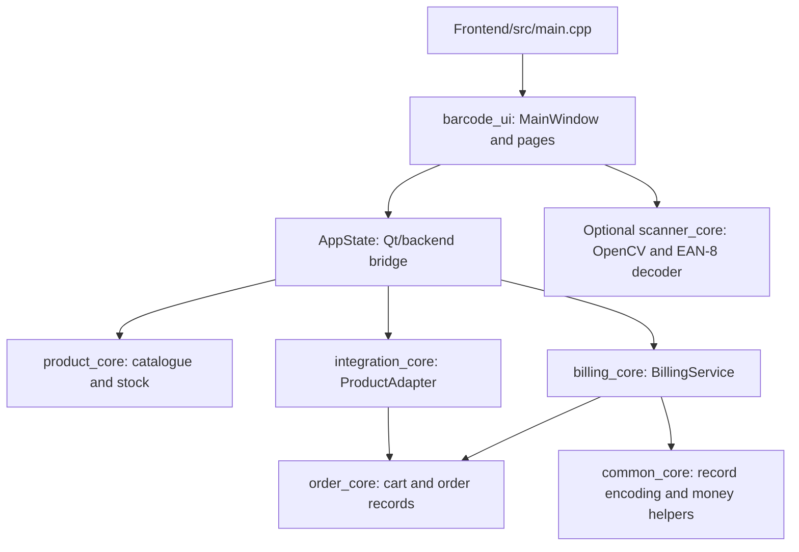

# Architecture and active entry points

The application separates the C++17 backend from Qt Widgets presentation.
[CMakeLists.txt](../../CMakeLists.txt) is the authority for which files are built.

## Responsibilities

| Component | Responsibility |
| --- | --- |
| `product_core` | Parse and validate catalogue records; lookup, descriptions and stock operations |
| `order_core` | Validate cart snapshots; generate order IDs; store headers and details |
| `integration_core` | Convert a `Product` into the order module's `ProductSnapshot` |
| `billing_core` | Calculate totals, select payment strategy, create and persist bills |
| `common_core` | Encode text fields, format money/quantities, split billing records |
| `barcode_ui` | Pages, dialogs, styling, state cache and checkout coordination |
| `scanner_core` | Read camera frames and decode full EAN-8 barcodes when enabled |

`backend_core` is a CMake interface target that collects backend dependencies.
Product lookup is injected into `BillingService`; billing does not directly own
the product catalogue. Payment strategies and product validation rules have
extension interfaces. Persistence uses local text files, with no database server.

## Active versus historical files

- `BarcodeHub` starts at [Frontend/src/main.cpp](../../Frontend/src/main.cpp).
- Main POS camera capture uses `CameraFeedWidget` in [Widgets.cpp](../../Frontend/src/ui/Widgets.cpp).
- `CameraDemo`, when enabled, uses [tests/camera_demo.cpp](../../tests/camera_demo.cpp)
  and `Frontend/src/ui/CameraWidget.cpp`.
- Root `cameraScanner.cpp`, `cameraScanner.h`, and `decoder.cpp` are not the
  sources selected for `scanner_core`; the backend scanner directory is used.
- `Frontend/src/ui/main.cpp`, `Frontend/legacy-camera`, and empty `POSWindow`
  files are outside the main executable's active implementation.
- `tests/regression.cpp` references old interfaces and is not registered by CMake.

The diagram describes source structure. It does not establish GUI readiness;
the checked-in frontend has a [confirmed compilation blocker](limitations.md).
